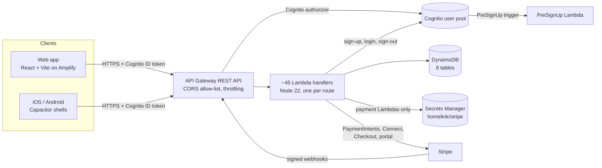

# HomeLink backend: developer guide

The backend is an AWS CDK app (JavaScript) that deploys one stack, `HomeLinkBackendStack`, to Sydney (`ap-southeast-2`). It serves the HomeLink web and mobile apps (`homelink-team-26-frontend`) through API Gateway and Lambda, stores data in DynamoDB, signs people in with Cognito, and takes payments through Stripe.

Related docs: [DEPLOY_PLAN.md](DEPLOY_PLAN.md) (deploying), [PAYMENT_INTEGRATION.md](PAYMENT_INTEGRATION.md) (payments, payouts, Pro), [API_REFERENCE.md](API_REFERENCE.md) (endpoints), [SECURITY.md](SECURITY.md) (security review).

## Architecture



**Request path.** The app sends the Cognito **ID token** as `Authorization: Bearer …`. ID tokens last an hour, and the app renews them with `POST /auth/refresh` (refresh token → new ID and access tokens). Logout revokes the refresh token. API Gateway's Cognito authorizer verifies it. The handler reads the caller from the `custom:userId` and `custom:role` claims (`getUserId` / `getUserRole` in `utils.js`). Public routes (sign-in, sign-up, browsing tradies, the Stripe webhook) have no authorizer.

**Bookings** carry `tradieName` and `homeownerName`, copied when the booking is made. Reads fill them in for older bookings without writing back.

**Money path.** A homeowner pays with a Stripe destination charge. The backend calculates the amount from the tradie's rate (`calculatePricing` in `business-logic.js`): job price + 5% service fee + a card-fee markup. The tradie's Stripe Connect account receives the job price minus 10% commission (0% for Pro tradies), and HomeLink keeps the rest as the application fee. Webhooks confirm payments, payout readiness and Pro subscriptions. Cancelling a paid booking with a refund (`/payments/refund-quote`, `/payments/cancel-booking`) exists behind the `refundsEnabled` flag, off by default. Its policy is configuration; see PAYMENT_INTEGRATION.md.

### Code layout

| Path | What's there |
| --- | --- |
| `bin/homelink-26-backend.js` | CDK entry point (region defaults to `ap-southeast-2`) |
| `lib/stack.js` | API routes, Lambdas, IAM grants, CORS, throttling, Stripe config |
| `lib/tables.js` | The 8 DynamoDB tables and their indexes |
| `lib/cognito.js` | User pool, app clients, PreSignUp trigger, optional SES email |
| `lib/lambdas/<area>/index.js` | Handlers for one area: auth, availability, bookings, messages, notifications, payments, pricing, profiles, reviews, schedule, search |
| `lib/lambdas/<area>/utils.js` | Shared helpers (responses, CORS, identity, validation). **Identical in every folder**; edit one and copy it to all (a test checks) |
| `lib/lambdas/<area>/business-logic.js` | Availability and pricing rules. **Identical in every folder**, same rule |
| `lib/lambdas/payments/refunds.js` | Refund policy as pure functions (configuration-driven) |
| `lib/lambdas/<area>/package.json` | Each Lambda bundles its own `aws-sdk` (v2) and, for payments, `stripe` |
| `test/` | Jest tests. Handlers run with AWS and Stripe mocked; stack tests check the synthesized template |
| `scripts/install-lambdas.js` | Installs each Lambda folder's dependencies before deploying |

### Data

| Table | Key | Indexes | Holds |
| --- | --- | --- | --- |
| Users | `userId` | Role, Email, TradeRate | Homeowners and tradies, Stripe account/customer IDs, Pro status |
| Bookings | `bookingId` | TradieId (by date), HomeownerId, Status | Requests, status, payment status, arrival tracking |
| Payments | `paymentId` | BookingId, HomeownerId | One record per successful payment |
| Messages | `bookingId` + `messageTimestamp` | UserId | Booking conversations |
| Notifications | `userId` + `notificationId` | — | In-app alerts |
| Reviews | `reviewId` | TradieId, BookingId | Ratings |
| Schedule | `tradieId` + `scheduleType` | — | Working hours (`working-hours`) and days off (`unavailable-YYYY-MM-DD`) |
| Profiles | `tradieId` | Trade, Location | Extended tradie profile |

User records are keyed by `custom:userId`, set once at registration. The Cognito `sub` is not used as an ID.

## Setup

Requirements: Node 22, npm, and (only for deploying) the AWS CLI v2 with credentials for the HomeLink account.

```bash
npm ci
npm test
```

`npm test` needs no AWS account or Stripe key: everything external is mocked. To check the infrastructure compiles:

```bash
npx cdk synth -q
```

Before deploying, install every Lambda's own dependencies:

```bash
npm run install:lambdas
```

Then follow [DEPLOY_PLAN.md](DEPLOY_PLAN.md). Use `npx cdk diff` and `npx cdk deploy`, not `npm run cdk:deploy`, which skips the approval prompt.

### Working on a handler

1. Change `lib/lambdas/<area>/index.js`.
2. If you change `utils.js` or `business-logic.js`, copy it to every Lambda folder and to `lib/`:
   ```bash
   for d in lib/lambdas/*/; do cp lib/lambdas/payments/utils.js "$d"; done; cp lib/lambdas/payments/utils.js lib/
   ```
3. If the handler needs a new table, Cognito action or secret, grant it in its `createLambdaFunction(...)` call in `lib/stack.js`. Grants are per function, and the stack tests fail on wildcard IAM.
4. Add a Jest test next to the existing ones in `test/`. The mocking pattern is at the top of each file.

## Configuration

Names only. Values come from CDK context, the deployed stack or Secrets Manager.

### CDK context (`--context key=value` on `cdk diff` / `cdk deploy`)

| Key | Purpose |
| --- | --- |
| `frontendUrl` | Web app URL: Stripe return links and an allowed CORS origin |
| `allowedOrigins` | Extra CORS origins, comma-separated (e.g. the Capacitor apps) |
| `apiRateLimit`, `apiBurstLimit` | Stage-wide API throttle |
| `stripeSecretName` | Secrets Manager secret holding the Stripe keys |
| `stripeCurrency` | Currency for booking payments |
| `stripeFeePercent`, `stripeFeeFixed` | Card fee passed on to homeowners |
| `proMonthlyPriceId`, `proAnnualPriceId` | Stripe Price IDs for HomeLink Pro (optional) |
| `proCurrency`, `proMonthlyPriceCents`, `proAnnualPriceCents` | Inline Pro prices when no Price IDs are set |
| `sesFromEmail`, `sesFromName`, `sesReplyTo`, `sesVerifiedDomain`, `sesConfigurationSet` | Send Cognito emails through SES instead of Cognito's built-in sender |
| `refundsEnabled` | Turn on cancelling paid bookings with a refund (default off) |
| `refundCutoffHours`, `refundLatePercent`, `refundKeepServiceFee`, `refundKeepProcessingFee` | Refund policy (placeholders until decided) |
| `businessTimezone` | Time zone booking times are in, for the refund cut-off |

### Deploy-time environment

| Variable | Purpose |
| --- | --- |
| `CDK_DEFAULT_ACCOUNT` | AWS account to deploy to (set by the CLI from your credentials) |
| `CDK_DEFAULT_REGION` | Region; the app defaults to `ap-southeast-2` |

### Lambda environment (set by the stack; don't set by hand)

| Variable | Purpose |
| --- | --- |
| `USERS_TABLE`, `BOOKINGS_TABLE`, `PAYMENTS_TABLE`, `MESSAGES_TABLE`, `NOTIFICATIONS_TABLE`, `REVIEWS_TABLE`, `SCHEDULE_TABLE`, `PROFILES_TABLE` | Table names |
| `USER_POOL_ID`, `CLIENT_ID`, `REGISTRATION_CLIENT_ID` | Cognito pool, public app client, backend registration client |
| `ALLOWED_ORIGINS` | CORS allow-list echoed in responses |
| `FRONTEND_URL` | Base for Stripe return links (hash routes, `/#/…`) |
| `STRIPE_SECRET_ID` | Name of the Stripe secret |
| `STRIPE_CURRENCY`, `STRIPE_FEE_PERCENT`, `STRIPE_FEE_FIXED` | Payment currency and card-fee markup |
| `PRO_MONTHLY_PRICE_ID`, `PRO_ANNUAL_PRICE_ID`, `PRO_CURRENCY`, `PRO_MONTHLY_PRICE_CENTS`, `PRO_ANNUAL_PRICE_CENTS` | HomeLink Pro pricing |
| `REFUNDS_ENABLED`, `REFUND_CUTOFF_HOURS`, `REFUND_LATE_PERCENT`, `REFUND_KEEP_SERVICE_FEE`, `REFUND_KEEP_PROCESSING_FEE`, `BUSINESS_TIMEZONE` | Refund flag and policy |
| `AWS_REGION` | Provided by Lambda |

### Stripe secret (`homelink/stripe`, JSON)

| Key | Purpose |
| --- | --- |
| `secretKey` | Stripe secret key (`sk_test_…` / `sk_live_…`) |
| `webhookSecret` | Signing secret of the account-events webhook endpoint |
| `connectWebhookSecret` | Signing secret of the connected-account-events endpoint |

## Conventions

- Responses go through `response()` / `errorResponse()` so they carry CORS and security headers.
- Validate input with the helpers in `utils.js` (`isValidDate`, `isValidTime`, `parseHourlyRate`, `isOptionalString`, `getLimit`). Never trust IDs, amounts or roles from the request body.
- Read the caller only from `getUserId(event)` / `getUserRole(event)`.
- Writes that can race use DynamoDB condition expressions, and a `ConditionalCheckFailedException` becomes a 409.
- Anything that talks to Stripe must be safe to retry: use idempotency keys and conditional writes.
